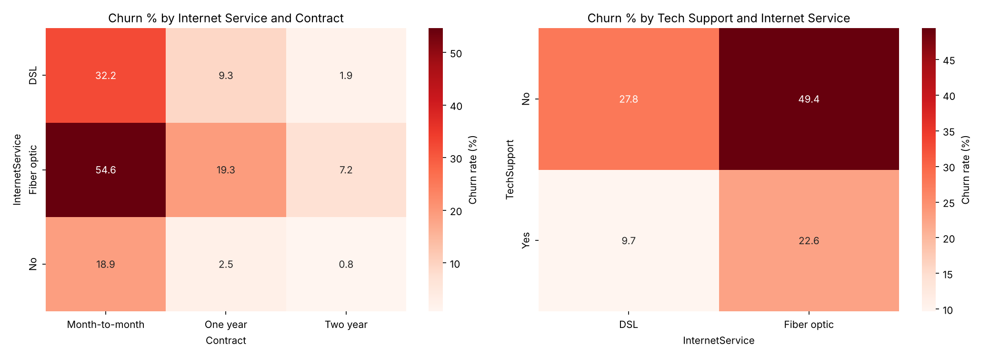
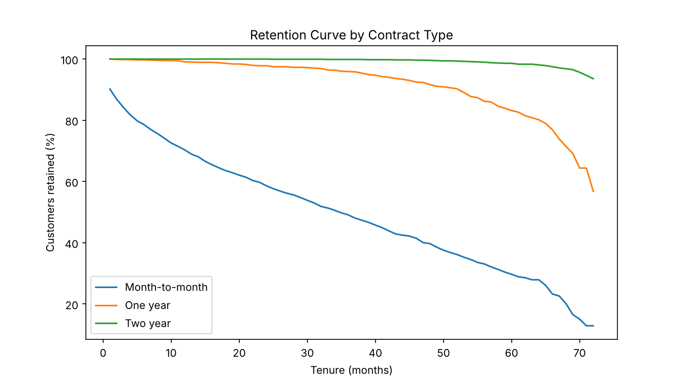
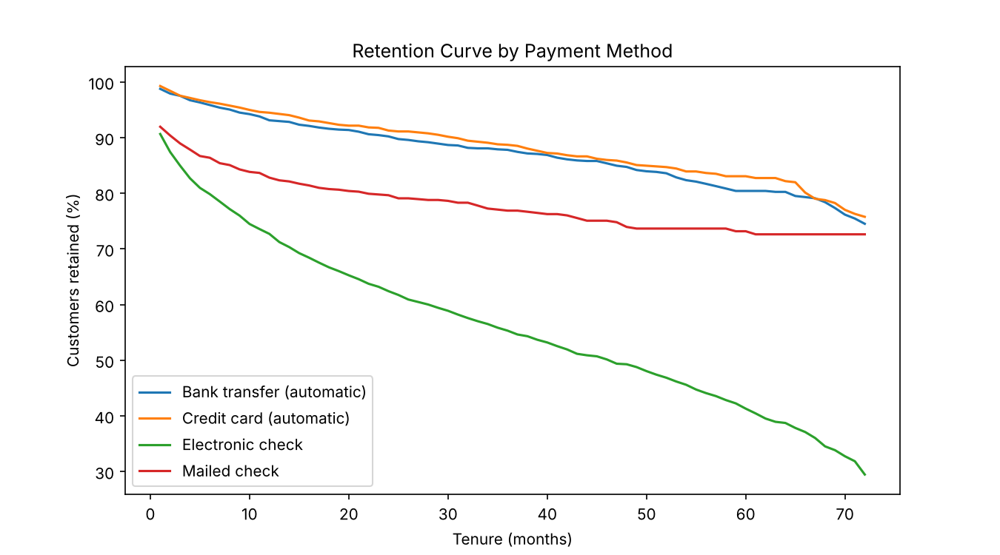
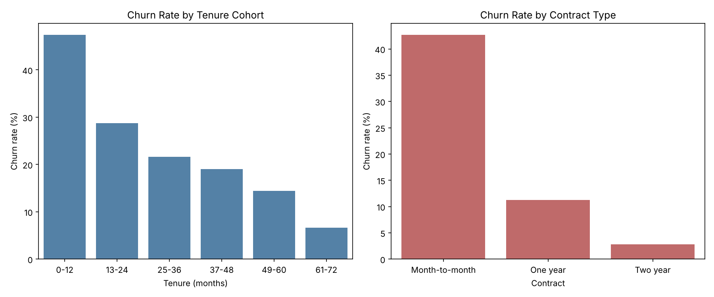

# Customer Churn & Retention Analysis: Telco Dataset

**Datheon Internship, Task 2**

Python analysis of customer retention using the IBM Telco Customer Churn dataset (7,043 customers, 21 columns).
The project segments customers by tenure, contract type, payment method and monthly charges, builds retention curves,
and finds the highest-risk customer segments.

## Objective

Understand which customers leave (churn), when they leave, and which customer segments are at the highest risk,
so that retention efforts can be targeted effectively.

## Key Findings

- **Overall churn rate:** 26.5% (1,869 of 7,043 customers)
- **Tenure:** customers in their first 12 months churn at 47.4%, customers with 61-72 months at 6.6%
- **Contract:** month-to-month 42.7%, one year 11.3%, two year 2.8%
- **Payment method:** electronic check 45.3% vs credit card (automatic) 15.2%
- **Monthly charges:** customers paying $60-$120 churn at about 33-34%, vs 9.8% for those paying under $30
- **Riskiest segment:** month-to-month + fiber optic + no tech support + electronic check
  (1,138 customers, 62.9% churn, 38.3% of all churn)

These are patterns in the data (correlation), not proof of cause.

## Charts






## Project Files

| File | Description |
|---|---|
| `churn_analysis.py` | Full analysis script (cleaning, cohorts, retention curves, risk segments, heatmaps) |
| `telco_customer_churn.csv` | Dataset |
| `high_risk_segments.csv` | Output: customer segments ranked by churn rate |
| `*.png` | Output charts |

## Method

1. Load and clean the data (`TotalCharges` blanks for new customers set to 0)
2. Baseline churn rate = churned customers / total customers
3. Tenure cohorts (0-12, 13-24, ... months) and contract types
4. Churn by payment method and monthly charge bands
5. Retention curves using the Kaplan-Meier method (implemented with pandas and NumPy)
6. High-risk segments, e.g. fiber optic users without tech support
7. Churn heatmaps by service tier

## Recommendations

1. Focus onboarding and retention offers on the first 12 months
2. Move month-to-month customers to 1-2 year contracts
3. Encourage automatic payment instead of electronic check
4. Promote tech support to fiber optic customers, ideally validated with an A/B test

## Tools Used

Python, pandas, NumPy, Matplotlib, Seaborn

## How to Run

```bash
pip install pandas numpy matplotlib seaborn
python churn_analysis.py
```

## Author

Asghar | Data Analytics Intern at Datheon
